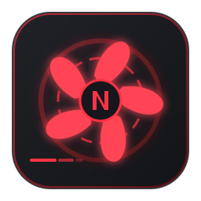
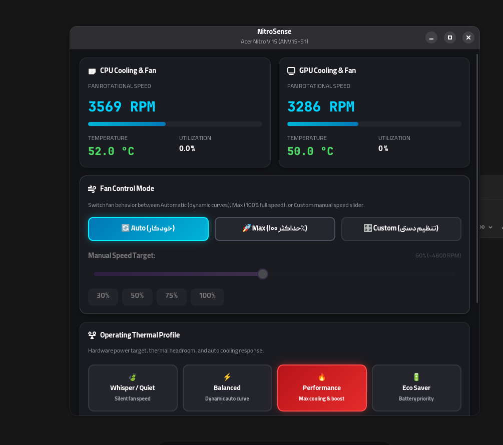
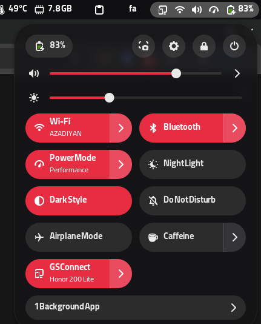

<div align="center">



# NitroSense On Linux

### 🔥 The Ultimate Native Thermal & Fan Control Center for Acer Nitro & Predator Laptops

[](#)
[](#)
[](#)
[](#)
[](#)
[](LICENSE)

[Overview](#-overview) • [Screenshots](#-visual-showcase) • [Features](#-key-features) • [Installation](#-quick-installation) • [CLI Guide](#-cli-reference) • [Architecture](#-architecture)

---

</div>

## 📖 Overview

**NitroSense On Linux** is an advanced, native hardware control suite engineered specifically for Acer gaming laptops (**Acer Nitro V 15 ANV15-51**, Nitro 5/16/17, and Predator Helios series).

On Linux, Acer laptops lack official control center software, causing fans to run only on default curves and ACPI thermal profiles to constantly reset back to balanced mode after application closure or power state transitions. **NitroSense On Linux** completely solves these issues with:
- A modern **Libadwaita / GTK4** dark gaming interface.
- A native **GNOME Shell Quick Settings & Top-Bar Extension**.
- A resilient **systemd background daemon (`nitrosensed`)** guaranteeing persistent thermal modes across reboots and sleep/wake cycles.
- A versatile **CLI & terminal ASCII dashboard** for power users.

---

## 📸 Visual Showcase

<div align="center">
  <table>
    <tr>
      <td width="55%" align="center">
        <b>Modern Libadwaita / GTK4 Interface</b><br/>
        <sub>Live RPM dials, temperatures, NVIDIA RTX wattage & fan sliders</sub>
      </td>
      <td width="45%" align="center">
        <b>GNOME Quick Settings & Top Bar</b><br/>
        <sub>Integrated 3-profile switcher & dynamic CPU indicator icon</sub>
      </td>
    </tr>
    <tr>
      <td align="center">
        
      </td>
      <td align="center">
        
      </td>
    </tr>
  </table>
</div>

---

## ✨ Key Features

### 🎛️ Dual-Fan Hardware Speed Control
- **Auto**: Dynamic firmware cooling curves that scale with temperatures.
- **Max (100% Turbo)**: Unleashes maximum dual-fan rotational speed (~7800+ RPM) for heavy gaming, compiling, and rendering.
- **Custom Manual Slider**: Fine-tune custom fan speed percentage from 25% to 100% with preset quick-jump buttons (30%, 50%, 75%, 100%).

### ⚡ Operating Thermal Profiles
- 🔥 **Performance**: Maximum power target, CPU/GPU clock boost, and aggressive cooling headroom.
- ⚡ **Balanced**: Ideal everyday compromise between acoustic comfort and processing performance.
- 🍃 **Whisper / Quiet**: Enforces silent fan limits for library, classroom, and office environments.
- 🔋 **Eco Saver**: Optimizes energy consumption to maximize portable battery life.

### 🛡️ Hardware Persistence Daemon (`nitrosensed`)
- Runs silently in the background as a lightweight systemd service.
- **Never reverts to balanced**: Continuously watches the ACPI sysfs node and ensures your chosen mode remains active.
- Seamlessly survives application closes, system suspend/resume (sleep/wake), and complete power shutdowns.
- Resolves kernel conflicts and TuneD `throughput-performance` profile crashes on Acer hardware.

### 🧩 Native GNOME Quick Settings Extension
- Adds a dedicated quick toggle button directly inside GNOME Shell's Quick Settings grid.
- Expandable popup sub-menu with one-click profile switching and checkmarks:
  - **Performance**
  - **Balanced**
  - **Whisper / Quiet**
- Shortcut button to open the full graphical interface directly from the menu.
- **Top-Bar Status Indicator**: Replaces the generic battery icon with a live CPU status indicator positioned right next to your battery:
  - **Performance**: Tachometer gauge icon (`power-profile-performance-symbolic`).
  - **Balanced**: Hidden icon (clean top bar, adhering to native GNOME design standards).
  - **Whisper**: Eco leaf icon (`power-profile-power-saver-symbolic`).

### 📊 Comprehensive Hardware Telemetry
- Dual-fan rotational speed (RPM) with color-coded live progress meters.
- CPU & GPU real-time temperatures (°C) and workload percentages (%).
- Dedicated **NVIDIA GeForce RTX (3050 / 4050 / etc.)** live power draw (Watts) and VRAM usage monitor.
- System RAM utilization and battery charging status tracking.

### 💻 Feature-Rich CLI & Live TUI
- Full ASCII terminal dashboard with colored status bars.
- Live real-time monitoring mode with `nitrosense watch`.
- Single-command switching for scripts and terminal workflows.

---

## 💻 Hardware & Distro Compatibility

### Supported Hardware
- **Acer Nitro V 15** (ANV15-51)
- **Acer Nitro 5** (AN515-xx, AN517-xx)
- **Acer Nitro 16 / 17**
- **Acer Predator Helios 300 / 16 / 18**
- Any Acer laptop exposing ACPI platform profiles & `acer-wmi` PWM fan controls.

### Supported Distributions
| Distribution Family | Package Manager | Status |
| :--- | :--- | :--- |
| **Fedora / RHEL / CentOS / Rocky** | `dnf` / `yum` | ✅ Fully Supported (Includes TuneD Acer ACPI Fix) |
| **Debian / Ubuntu / Pop!_OS / Linux Mint** | `apt` | ✅ Fully Supported |
| **Arch Linux / Manjaro / EndeavourOS** | `pacman` | ✅ Fully Supported |
| **openSUSE Tumbleweed / Leap** | `zypper` | ✅ Fully Supported |

---

## 🚀 Quick Installation

Clone this repository and run the automated universal installer:

```bash
git clone https://github.com/AzadiyanDev/Nitrosense-On-Linux.git
cd Nitrosense-On-Linux
chmod +x install.sh
sudo ./install.sh
```

### What the installer handles:
1. Detects your Linux distribution and installs all required dependencies (`python3-gobject`, `gtk4`, `libadwaita`, etc.).
2. Installs the `nitrosense` CLI and GUI tools to `/usr/local/bin` and `/usr/local/share/nitrosense`.
3. Deploys and enables `nitrosensed.service` and systemd sleep/resume power hooks.
4. Corrects sysfs permissions for unprivileged control.
5. Deploys the GNOME Shell Quick Settings Extension system-wide.
6. Registers desktop application shortcuts and SVG icons.

> [!TIP]
> **GNOME Wayland Users**: In Wayland sessions, newly installed extensions are discovered when GNOME Shell initializes. **Log Out and Log back In** once after installation to load the extension into your top panel.

---

## ⌨️ CLI Reference

NitroSense includes a powerful command-line interface for terminal users:

```bash
# View the ASCII system status dashboard
nitrosense

# Live real-time terminal monitor
nitrosense watch
# or
nitrosense -w

# Switch operating thermal profiles
nitrosense perf          # Switch to Performance mode
nitrosense balanced      # Switch to Balanced mode
nitrosense quiet         # Switch to Whisper / Quiet mode
nitrosense eco           # Switch to Eco Saver mode

# Switch fan cooling modes
nitrosense auto          # Enable dynamic automatic cooling curves
nitrosense max           # Full 100% turbo cooling (~7800 RPM)

# Set custom fan speed percentage (25% to 100%)
nitrosense fan 60        # Set fans to 60% (~4800 RPM)
nitrosense fan 80        # Set fans to 80% (~6400 RPM)

# Launch the GTK4 / Libadwaita GUI
nitrosense gui

# Check current active profile
nitrosense get-profile
```

---

## 🏗️ Architecture

```
┌──────────────────────────────────────────────────────────┐
│                   User Interfaces                        │
│   [GNOME Quick Settings]    [Libadwaita GUI]   [CLI TUI] │
└───────────────┬───────────────────┬────────────────┬─────┘
                │                   │                │
                ▼                   ▼                ▼
┌──────────────────────────────────────────────────────────┐
│                 NitroSense Python Core                   │
│               (/usr/local/share/nitrosense)              │
│       • Config Manager: /etc/nitrosense/config.json      │
│       • TuneD Profile Synchronizer (throughput-perf)     │
└─────────────────────────────┬────────────────────────────┘
                              │
                              ▼
┌──────────────────────────────────────────────────────────┐
│          Background Daemon (nitrosensed.service)         │
│       • Enforces persistence across sleep/wake/reboots   │
│       • Auto-corrects unauthorized profile reverts       │
└─────────────────────────────┬────────────────────────────┘
                              │
                              ▼
┌──────────────────────────────────────────────────────────┐
│                    Linux Kernel & Sysfs                  │
│       • /sys/firmware/acpi/platform_profile              │
│       • /sys/devices/platform/acer-wmi/hwmon/hwmonX/     │
│       • Embedded Controller (EC) PWM Fan Registers       │
└──────────────────────────────────────────────────────────┘
```

---

## 🗂️ Repository Structure

```
Nitrosense-On-Linux/
├── bin/
│   ├── nitrosense                 # CLI Controller executable
│   └── nitrosensed                # Background persistence daemon
├── src/
│   ├── backend.py                 # Core hardware interface (ACPI & WMI)
│   └── gui.py                     # Modern Libadwaita / GTK4 GUI
├── extension/
│   └── nitrosense-quicksettings@azadiyan/
│       ├── metadata.json          # GNOME Shell extension metadata
│       └── extension.js           # Quick Settings & Top Bar integration
├── systemd/
│   ├── nitrosensed.service        # Systemd unit for hardware persistence
│   ├── nitrosense-sleep.sh        # Suspend/Resume power hook
│   └── nitro-platform-profile.conf # Permissions configuration for sysfs
├── desktop/
│   ├── nitrosense.desktop         # FreeDesktop Application shortcut
│   └── nitrosense.svg             # Vector application icon
├── assets/
│   ├── icon.svg                   # Project logo
│   └── screenshots/               # Documentation screenshots
├── install.sh                     # Universal one-command installer
├── uninstall.sh                   # Clean uninstaller
├── LICENSE                        # MIT License
└── README.md                      # Comprehensive documentation
```

---

## 🗑️ Uninstallation

To completely remove NitroSense and its background services:

```bash
cd Nitrosense-On-Linux
chmod +x uninstall.sh
sudo ./uninstall.sh
```

---

## 🤝 Contributing

Contributions, issues, and feature requests are welcome! Feel free to check the [issues page](https://github.com/AzadiyanDev/Nitrosense-On-Linux/issues).

1. Fork the Project
2. Create your Feature Branch (`git checkout -b feature/AmazingFeature`)
3. Commit your Changes (`git commit -m 'Add some AmazingFeature'`)
4. Push to the Branch (`git push origin feature/AmazingFeature`)
5. Open a Pull Request

---

## 📄 License

Distributed under the **MIT License**. See [LICENSE](LICENSE) for more information.

---

<div align="center">
  <b>Developed with ❤️ for the Linux Gaming Community by <a href="https://github.com/AzadiyanDev">AzadiyanDev</a></b>
</div>
